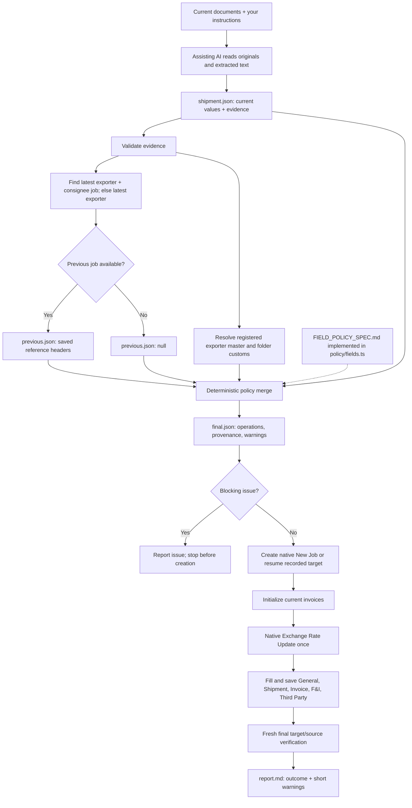

# Impex Cube shipment headers

This project creates and saves Impex Cube job headers from shipment documents. Give the assisting AI a document folder and any special instructions. It extracts current values; a script combines them with the latest suitable previous job under [FIELD_POLICY_SPEC.md](FIELD_POLICY_SPEC.md).

The result is a distinct native New Job, with the current shipment's invoices and verified saved headers. Products, HSN/duty calculations, uploads, approval and filing stay outside this project. Product work belongs in the sibling `impexcube-products` project.

## Start here

Run commands from this repository's root so every attempt uses the same `runs/` directory and recovery records.

```bash
bun install
cp -n .env.example .env
chmod 600 .env
```

Fill in `IMPEX_USERNAME` and `IMPEX_PASSWORD` in the ignored `.env`. Keep `IMPEX_DEFAULT_BRANCH=MORADABAD`, or choose `DELHI`. The exporter must already have a registered master in that branch; registration is manual.

| Setting | Purpose |
|---|---|
| `IMPEX_DEFAULT_BRANCH` | Branch when `--branch` is omitted; required only without that option |
| `IMPEX_FINANCIAL_YEAR` | Optional year such as `2026-2027`; otherwise current Indian financial year |
| `IMPEX_HEADED=1` | Show the browser while processing |
| `IMPEX_BROWSER_EXECUTABLE` | Chromium path; defaults to `/usr/bin/chromium` |

Install Chromium at that path or set the override. Browser login state is never saved.

1. Put current documents in `incoming/<customs-code>_<number>/`, for example `incoming/INMBD6_001/`. The suffix is a shipment sequence number. The customs code resolves against the live site master; account branch is a separate setting.
2. Include PDF, DOCX, XLSX, XLS, TXT or Markdown files. Subfolders are supported; symbolic links are rejected.
3. Ask the assistant: **“Process `incoming/INMBD6_001` for MORADABAD, financial year 2026-2027. [Any special instructions.]”**
4. The assistant reads originals and extracted text, prepares evidence, runs the automation and reports the target job and outcome. You supply documents and instructions; the assistant writes the internal JSON.

The standalone CLI reads documents and runs deterministic policy/browser actions. AI interpretation happens through the assisting AI; `extract` alone does not interpret a shipment.

## Pipeline



Selection is scoped to branch/year. With an explicit IEC, headers are checked newest first until the consignee matches; missing consignee stops at the latest eligible exporter header. Exporter-name searches check the complete result set to establish an unambiguous IEC. Native consignee search is not used to exclude headers because its matching differs from our name normalization. Previous invoice count never changes selection. Previous data supplies header fallbacks; native New Job creates the target without copying Products or invoice rows. Current documents determine invoice identities and count.

## Commands used by the assistant

```bash
bun run impex extract incoming/INMBD6_001 --branch MORADABAD --year 2026-2027
# Assistant now completes shipment.json from originals, source quotes and explicit instructions.
bun run impex validate incoming/INMBD6_001 --branch MORADABAD --year 2026-2027
bun run impex prepare incoming/INMBD6_001 --branch MORADABAD --year 2026-2027
bun run impex run incoming/INMBD6_001 --branch MORADABAD --year 2026-2027
```

| Command | What it does | Website writes |
|---|---|---|
| `extract <folder>` | Read supported files; initialize internal `shipment.json`; print sources and hashes | None |
| `validate <folder>` | Check artifact, unchanged originals and evidence; require current invoices | None; policy/native requirements checked later |
| `prepare <folder>` | Discover reference, preview master/options and write `previous.json`/`final.json` | No Save/Add/Update; local artifacts may change |
| `run <folder>` | Prepare, create/resume, save and verify automatically | Yes |
| `resume <run-id>` | Continue the recorded target with unchanged inputs | Yes, if processing is needed |
| `resolve-target <run-id> <job>` | Record the exact target after uncertain creation and identity checks | No website Save |
| `inspect <branch> <year> <job>` | Print mapped saved headers | None |
| `help` | List commands and context options | None |

Folder commands accept `--branch` and `--year`; reuse the same context for a shipment. An unchanged verified run validates the artifact and original-file hashes, then returns its recorded result without converting documents or opening the browser. Changed inputs or policy require evidence validation and processing again. `prepare` is optional; `run` saves validated drafts automatically. Incomplete processing exits with code 2; command errors exit with code 1.

## Data and policy

Generated files live in ignored `runs/<branch>-<year>-<folder>/`. For the example above, the run ID is `MORADABAD-2026-2027-INMBD6_001`.

| File | Contents | Produced by |
|---|---|---|
| `shipment.json` | Original-file hashes, current fields/evidence and explicit instructions | CLI initializes; assisting AI completes |
| `previous.json` | Selected previous headers, or `null` | Script |
| `final.json` | Resolved write operations, provenance, policy hash and issues | Policy script; site options canonicalize values |
| `journal.json` | Recorded target, creation/Add intents and recovery state | Automation |
| `report.md` | Status, target and short warnings | Automation |

[FIELD_POLICY_SPEC.md](FIELD_POLICY_SPEC.md) defines business rules; [src/policy/fields.ts](src/policy/fields.ts) implements them. There is one executable policy source.

| Rule | Result |
|---|---|
| Doc Only | Current evidence/instructions; otherwise empty with warning |
| Doc → Past Fallback | Current, then previous, then empty with warning |
| Fixed / Default | Configured value always wins; disagreements produce a short warning |
| System Locked | No automation write; site owns the value |

Unknown/null means unavailable. Blank, zero and false are explicit values. Missing gross/net weight units default to KGS; an explicitly supplied unit or blank takes precedence. Packing From/To/Unit stay empty and no numbered packing row is added; Total Packages/Unit remain separate document fields. Marks & Nos keeps the previous declaration and updates its recognized package count/range from the current shipment by default. Carton, package and box labels are recognized; ambiguous formats still stop for review. Explicit complete marks instructions override this default. Notify Party maps to Third Party. Invoice terms use central site aliases, for example DAP → CIF. Missing native-required fields or unrepresentable blanks stop processing with an actionable error.

## Revisions and recovery

| Situation | Action |
|---|---|
| Documents or instructions changed | First resolve any uncertain New Job/Invoice Add intent before editing inputs. Assistant repeats `extract`, reviews originals, updates evidence/file hashes, then repeats `run` with the same folder/context. It revises the recorded target. |
| Interrupted with unchanged inputs | `bun run impex resume <run-id>`; processing resumes on the recorded target. |
| New Job Save may have succeeded but target is unknown | Inspect the native site, identify the exact job created by this attempt, then `resolve-target <run-id> <job>` and `resume <run-id>`. Creation is never blindly retried. |
| Invoice Add response was uncertain | Inspect the exact index/number/date. Resume reconciles a matching visible row; absent or mismatched rows require manual resolution before continuing. Add is never blindly repeated. |
| Revised invoices differ from existing target rows | Reconcile the invoice layout manually. Existing rows must match the current ordered identities before another Add; automation does not delete rows. Currency changes can also require manual reconciliation before rate Update. |
| `runs/.lock` remains after a crash | Inspect its process ID and confirm that process has stopped before removing the stale lock manually. Never remove an active lock. |
| Obsolete manifests/payloads/flat journals found | Preserve old inputs/audits separately. This workflow rejects them and provides no compatibility migration. |

Never reset journals, rename a processed folder to force a new target, or assign an unrelated job during recovery. Matching exporter/context alone cannot establish ownership of a job.

## Code map

```text
src/
  cli.ts             Commands and execution context
  workflow.ts        Intake → prepare → execute/resume
  schemas.ts         Zod contracts and derived types
  values.ts          Dates, exact decimals, identity normalization
  journal.ts         Atomic records, lock and duplicate prevention
  report.ts          Outcome and warnings
  documents/
    read.ts          File discovery, hashes, OCR/spreadsheet extraction
    evidence.ts      Evidence checks and explicit instructions
  policy/
    fields.ts        Field rules, mappings and business checks
    merge.ts         Deterministic source selection per field
    select.ts        Previous-job selection
  website/           Native session, reads, creation, fill, rate update, verification
tests/               Policy, document and browser/recovery regressions
incoming/            Shipment documents (ignored)
runs/                Generated data and reports (ignored)
```

For contributing-agent instructions, read [AGENTS.md](AGENTS.md). Keep field-policy changes in `policy/fields.ts`, execution changes in `workflow.ts` and site mechanics in `website/`.

## Limits and verification

Verification covers mapped saved headers and source preservation, including exact foreign amount × site-updated exchange rate rounded to two INR decimals. It does not verify Products, duties, uploads or filing. PDF/DOCX extraction uses xberg with OCR; spreadsheets use xlsx. The assisting AI must inspect originals, especially OCR and formulas without cached values.

Multiple invoice currencies require manual handling. Eight auxiliary fields lack inspected native mappings and remain unsupported: flight number/date, CHA number, filing mode, SB type, EPZ code, RBI waiver and final provisional invoice. Warnings identify that limitation; a verified report does not claim those controls were applied.

Run after code changes:

```bash
bun test
bun run typecheck
bun run lint
bun run knip
```

Local browser fixtures establish regression coverage, not live acceptance. Live mutation tests require genuine new-shipment inputs or an explicitly designated disposable target. Keep credentials, shipment documents, reports and journals out of Git.
